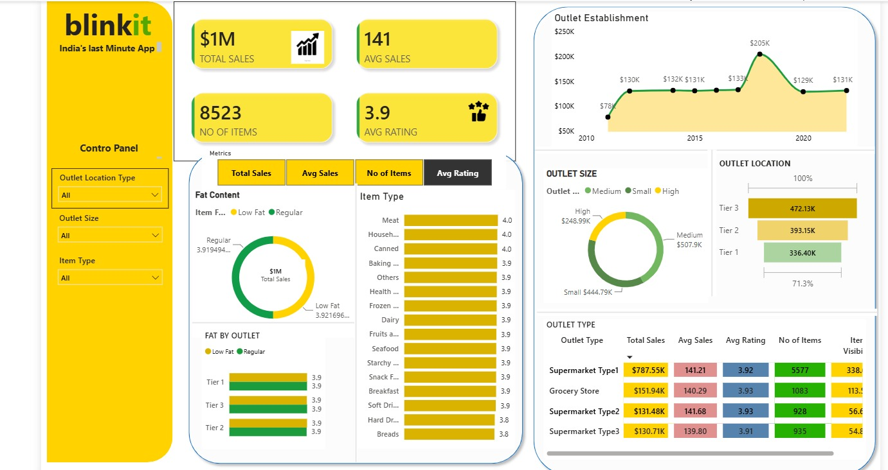

# Blinkit Sales Performance Analysis

## Project Overview
This is a Power BI dashboard project focused on analyzing retail sales performance, outlet characteristics, item categories, and customer ratings using a Blinkit-themed dataset.

## Dashboard Preview

## Key Performance Indicators
- Total Sales
- Average Sales
- Number of Items
- Average Customer Rating

## Analysis Covered
- Sales by item type
- Sales by outlet size and location tier
- Outlet type performance
- Outlet establishment trends
- Item-level sales and ratings

## Tools Used
- Microsoft Power BI

## Project Files
- `Blinkit sales analysis dashboard.pbix` — Interactive Power BI report file
- `Blinkit_dashboard.jpeg` — Dashboard preview image

## Learning Objectives
- Practice building interactive Power BI dashboards
- Explore retail sales data using visualizations
- Present business metrics in a clear and structured format

## Acknowledgment
This project was created as a learning exercise by following a Power BI tutorial.
Tutorial: https://youtu.be/mmxVCFceQgU?si=x4RIcIbYdI9GCmlz
Channel: Data Tutorials

